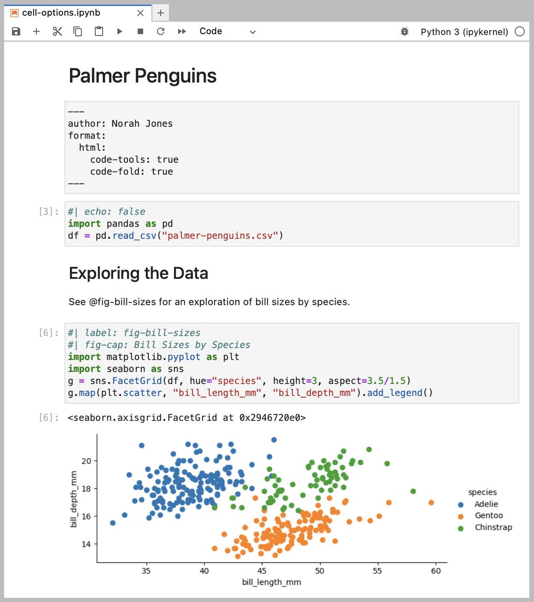
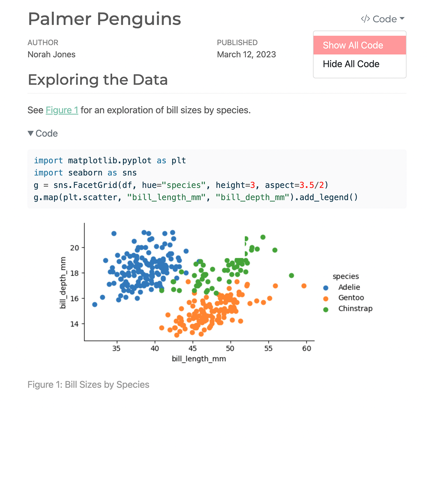
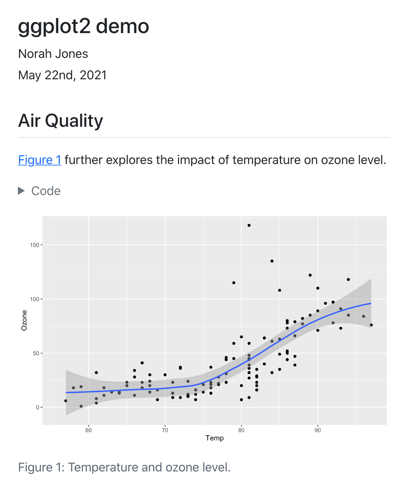
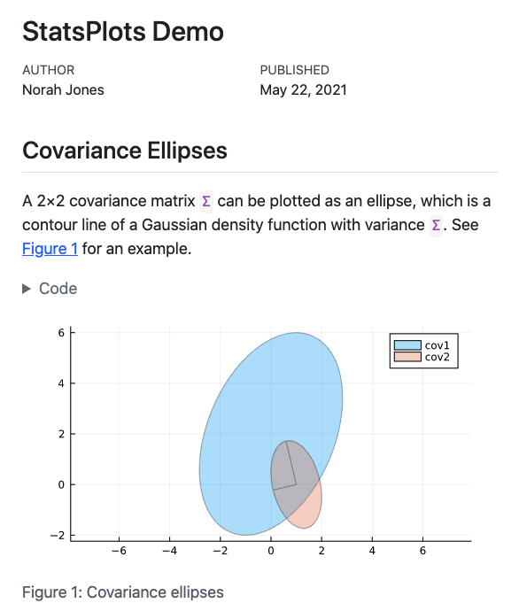
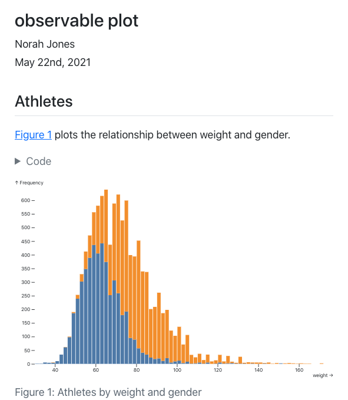

```{=html}
<!-- page-layout: custom emits no <main>, so supply the landmark here.
     role="main", not <main>: Quarto rewrites a <main> (hoists the h1 into a title block). -->
<div role="main">
```

::: {.hero-banner}

::: {.content-block .py-4}

::: {.hero-text}

# Welcome to Quarto^&ZeroWidthSpace;[®]{.trademark}^ {.mt-1}

::: {.h3}
An open-source scientific and technical publishing system
:::

- Author using [Jupyter](https://jupyter.org) notebooks or with plain text markdown in your favorite editor.
- Create dynamic content with [Python](/docs/computations/python.qmd), [R](/docs/computations/r.qmd), [Julia](/docs/computations/julia.qmd), and [Observable](/docs/computations/ojs.qmd).
- Publish reproducible, production quality articles, presentations, dashboards, websites, blogs, and books in HTML, PDF, MS Word, ePub, and more.
- Share knowledge and insights organization-wide by publishing to [Posit Connect](/docs/publishing/rstudio-connect.qmd), [Confluence](/docs/publishing/confluence.qmd), or other publishing systems.
- Write using [Pandoc](https://pandoc.org) markdown, including equations, citations, crossrefs, figure panels, callouts, advanced layout, and more.

::: {.h3}
Analyze. Share. Reproduce. You have a story to tell with data---tell it with Quarto.
:::

::: {.grid .gap-3 .pb-3 .pt-4}
::: {.g-col-12 .g-col-sm-4}
[Get Started](/docs/get-started/index.qmd){.btn-action-primary .btn-action .btn .btn-lg .w-100 role="button"}
:::
::: {.g-col-12 .g-col-sm-4 .mb-2}
[Guide](/docs/guide/){#btn-guide .btn-action .btn-secondary .btn .btn-lg .w-100 role="button"}
:::
:::
:::

::: {.hero-animation}

```{=html}
<script src="assets/js/lottie.min.js" defer integrity="sha384-J8C0MvgX4WP58J4N2W99vCKd2J6z99ynOJ5bEfE6jeP7kVTW1drYtv/jzrxM5jbm" crossorigin="anonymous"></script>
```

::: light-content

```{=html}
<div id="lottie-light"></div>
<script>
  document.addEventListener('DOMContentLoaded', function() {
    lottie.loadAnimation({
      container: document.getElementById('lottie-light'),
      renderer: 'svg',
      loop: true,
      autoplay: true,
      path: 'assets/images/hero-light/hero-animation.json'
    });
  });
</script>
```

:::

::: dark-content

```{=html}
<div id="lottie-dark"></div>
<script>
  document.addEventListener('DOMContentLoaded', function() {
    lottie.loadAnimation({
      container: document.getElementById('lottie-dark'),
      renderer: 'svg',
      loop: true,
      autoplay: true,
      path: 'assets/images/hero-dark/hero-animation.json'
    });
  });
</script>
```

:::

:::

:::

:::

::: {.content-block .home-chooser}

## Where do you want to go?

::: {.choices}

- [[[]{.bi .bi-rocket-takeoff}]{.choice-glyph aria-hidden="true"} [Get Started]{.choice-name} [Install Quarto and follow the tutorials.]{.choice-tagline}](/docs/get-started/index.qmd){.choice .sec-getstarted}
- [[[]{.bi .bi-signpost-split}]{.choice-glyph aria-hidden="true"} [Guide]{.choice-name} [Learn authoring, computations, formats and publishing.]{.choice-tagline}](/docs/guide/index.qmd){.choice .sec-guide}
- [[[]{.bi .bi-braces}]{.choice-glyph aria-hidden="true"} [Reference]{.choice-name} [Every option for formats, cells and projects.]{.choice-tagline}](/docs/reference/index.qmd){.choice .sec-reference}
- [[[]{.bi .bi-puzzle}]{.choice-glyph aria-hidden="true"} [Extensions]{.choice-name} [Find, use and create extensions.]{.choice-tagline}](/docs/extensions/index.qmd){.choice .sec-extensions}
- [[[]{.bi .bi-images}]{.choice-glyph aria-hidden="true"} [Gallery]{.choice-name} [Real-world examples, by what you want to make.]{.choice-tagline}](/docs/gallery/index.qmd){.choice .sec-gallery}
- [[[]{.bi .bi-newspaper}]{.choice-glyph aria-hidden="true"} [Blog [[]{.bi .bi-box-arrow-up-right}]{aria-hidden="true"} [(external site)]{.visually-hidden}]{.choice-name} [Release notes and news from the Quarto team.]{.choice-tagline}](https://opensource.posit.co/blog/q/quarto/){.choice .sec-blog}

:::

:::

::: {.hello-quarto .alt-background}
::: {.content-block}

## Hello, Quarto

<ul class="nav nav-pills d-flex flex-wrap" id="hello-quarto-tab" role="tablist">
  <li class="nav-item" role="presentation">
    <button class="nav-link active" id="python-tab" data-bs-toggle="tab" data-bs-target="#python" type="button" role="tab" aria-controls="python" aria-selected="true">Python</button>
  </li>
  <li class="nav-item" role="presentation">
    <button class="nav-link" id="knitr-tab" data-bs-toggle="tab" data-bs-target="#knitr" type="button" role="tab" aria-controls="knitr" aria-selected="false">R</button>
  </li>
  <li class="nav-item" role="presentation">
    <button class="nav-link" id="julia-tab" data-bs-toggle="tab" data-bs-target="#julia" type="button" role="tab" aria-controls="julia" aria-selected="false">Julia</button>
  </li>
  <li class="nav-item" role="presentation">
    <button class="nav-link" id="observable-tab" data-bs-toggle="tab" data-bs-target="#observable" type="button" role="tab" aria-controls="observable" aria-selected="false">Observable</button>
  </li>
</ul>

<div class="tab-content" id="hello-quarto-tabcontent">

<div class="tab-pane fade show active" id="python" role="tabpanel" aria-labelledby="python-tab">

::: {.demo}

::: {.demo-head}
[[]{.bi .bi-filetype-py}]{.demo-glyph aria-hidden="true"} Combine Jupyter notebooks with flexible options to produce production quality output in a wide variety of formats.
:::

::: {.demo-grid}

::: {.demo-cell}
{fig-alt="Example Jupyter notebook entitled Palmer Penguins with code cells, text, and a scatterplot."}
:::

::: {.demo-cell}
{fig-alt="Output of example Jupyter notebook, Palmer Penguins, in HTML showing title, metadata, text, code, and scatterplot. At the top there is a dropdown option to show or hide the code."}
:::

:::

:::

</div>

<div class="tab-pane fade" id="knitr" role="tabpanel" aria-labelledby="knitr-tab">

::: {.demo}

::: {.demo-head}
[[]{.bi .bi-r-circle}]{.demo-glyph aria-hidden="true"} Quarto is a multi-language, next generation version of R Markdown from Posit, with many new features and capabilities.
:::

::: {.demo-grid}

::: {.demo-cell}

````markdown
---
title: "ggplot2 demo"
author: "Norah Jones"
date: "5/22/2021"
format: 
  html:
    fig-width: 8
    fig-height: 4
    code-fold: true
---

## Air Quality

@fig-airquality further explores the impact of temperature on ozone level.

```{{r}}
#| label: fig-airquality
#| fig-cap: "Temperature and ozone level."
#| warning: false

library(ggplot2)
ggplot(airquality, aes(Temp, Ozone)) + 
  geom_point() + 
  geom_smooth(method = "loess")
```


````

:::

::: {.demo-cell}
{fig-alt="Example output with title (ggplot2 demo), author (Norah Jones), and date (5/22/2021). Below is a header reading Air Quality followed by body text (Figure 1 further explores the impact of temperature on ozone level.) with a toggleable code field, and figure with caption Figure 1 Temperature and ozone level."}
:::

:::

:::

</div>

<div class="tab-pane fade" id="julia" role="tabpanel" aria-labelledby="julia-tab">

::: {.demo}

::: {.demo-head}
[[]{.bi .bi-file-earmark-code}]{.demo-glyph aria-hidden="true"} Combine markdown and Julia code to create dynamic documents that are fully reproducible.
:::

::: {.demo-grid}

::: {.demo-cell}

````markdown
---
title: "Plots Demo"
author: "Norah Jones"
date: "5/22/2021"
format:
  html:
    code-fold: true
engine: julia
---

## Parametric Plots

Plot function pair (x(u), y(u)). 
See @fig-parametric for an example.

```{{julia}}
#| label: fig-parametric
#| fig-cap: "Parametric Plots"

using Plots

plot(sin, 
     x->sin(2x), 
     0, 
     2π, 
     leg=false, 
     fill=(0,:lavender))
```


````

:::

::: {.demo-cell}
{fig-alt="Example Plots Demo output with title, author, date published and main section on Parametric plots which contains text, a toggleable code field, and the output of the plot, with the caption Figure 1 Parametric Plots."}
:::

:::

:::

</div>

<div class="tab-pane fade" id="observable" role="tabpanel" aria-labelledby="observable-tab">

::: {.demo}

::: {.demo-head}
[[]{.bi .bi-filetype-js}]{.demo-glyph aria-hidden="true"} Quarto includes native support for Observable JS, a set of JavaScript enhancements created by Mike Bostock (the author of D3).
:::

::: {.demo-grid}

::: {.demo-cell}

````markdown
---
title: "observable plot"
author: "Norah Jones"
format: 
  html: 
    code-fold: true
---

## Seattle Precipitation by Day (2012 to 2016)

```{{ojs}}
data = FileAttachment("seattle-weather.csv")
  .csv({typed: true})
  
Plot.plot({
  width: 800, height: 500, padding: 0,
  color: { scheme: "blues", type: "sqrt"},
  y: { tickFormat: i => "JFMAMJJASOND"[i] },
  marks: [
    Plot.cell(data, Plot.group({fill: "mean"}, {
      x: d => new Date(d.date).getDate(),
      y: d => new Date(d.date).getMonth(),
      fill: "precipitation", 
      inset: 0.5
    }))
  ]
})
```
````

:::

::: {.demo-cell}
{fig-alt="Example output with title, author, and date. Below, the main section reads Seattle Precipitation by Day (2012 to 2016) with a toggleable section to show code and a heatmap of the precipitation by day."}
:::

:::

:::

</div>

</div>

:::
:::

::: {.content-block .home-features}

## Features

::: {.features}

::: {.feature}

### [[]{.bi .bi-cpu}]{.feature-glyph aria-hidden="true"} Dynamic Documents

Generate dynamic output using Python, R, Julia, and Observable. Create reproducible documents that can be regenerated when underlying assumptions or data change.

::: {.learn-more}
[Learn more »](/docs/computations/python.qmd)
:::

:::

::: {.feature}

### [[]{.bi .bi-file-earmark-text}]{.feature-glyph aria-hidden="true"} Beautiful Publications

Publish high-quality articles, reports, presentations, websites, and books in HTML, PDF, MS Word, ePub, and more. Use a single source document to target multiple formats.

::: {.learn-more}
[Learn more »](/docs/output-formats/all-formats.qmd)
:::

:::

::: {.feature}

### [[]{.bi .bi-pencil-square}]{.feature-glyph aria-hidden="true"} Scientific Markdown

Pandoc markdown has excellent support for LaTeX equations and citations. Quarto adds extensions for cross-references, figure panels, callouts, advanced page layout, and more.

::: {.learn-more}
[Learn more »](/docs/authoring/markdown-basics.qmd)
:::

:::

::: {.feature}

### [[]{.bi .bi-tools}]{.feature-glyph aria-hidden="true"} Authoring Tools

Use your favorite tools including Positron, VS Code, RStudio, Jupyter Lab, or any text editor. Use the Quarto visual markdown editor for long-form documents.

::: {.learn-more}
[Learn more »](/docs/get-started/index.qmd)
:::

:::

::: {.feature}

### [[]{.bi .bi-hand-index}]{.feature-glyph aria-hidden="true"} Interactivity

Engage readers by adding interactive data exploration to your documents using Jupyter Widgets, htmlwidgets for R, Observable JS, and Shiny.

::: {.learn-more}
[Learn more »](/docs/interactive/)
:::

:::

::: {.feature}

### [[]{.bi .bi-globe2}]{.feature-glyph aria-hidden="true"} Websites and Books

Publish collections of documents as a blog or full website. Create books and manuscripts in both print formats (PDF and MS Word) and online formats (HTML and ePub).

::: {.learn-more}
[Learn more »](/docs/websites/)
:::

:::

:::

:::

::: {.get-started .alt-background}
::: {.content-block .py-5 .grid}
::: {.g-start-4 .g-col-6 .g-start-md-5 .g-col-md-3 .pt-1}
[Get Started](/docs/get-started/index.qmd){.btn-action-primary  .btn-action .btn .btn-lg .w-100 role="button"}

:::
:::
:::

```{=html}
</div>
```
